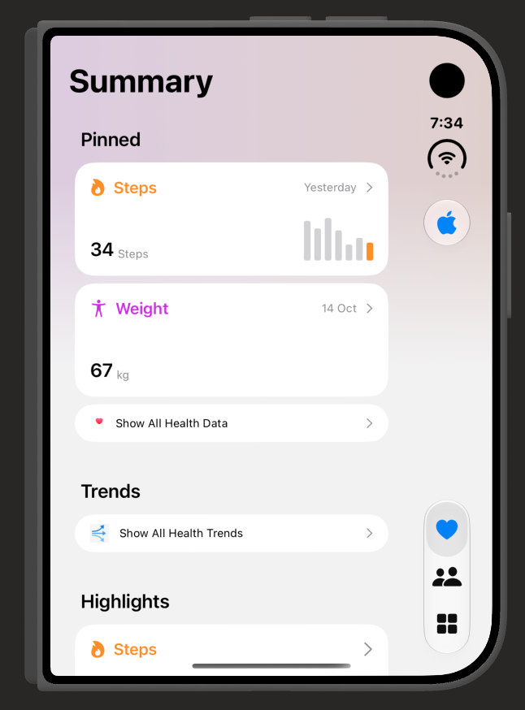

# Health App Simulator

A SwiftUI prototype of an Apple Health style summary screen. It includes pinned health cards, trends, activity and workout highlights, and light and dark appearance previews.

## Preview

## Run

Open `health-ui.xcodeproj` in Xcode, select the `health-ui` scheme, and run on an iOS simulator. The project currently uses sample data and does not connect to HealthKit.
